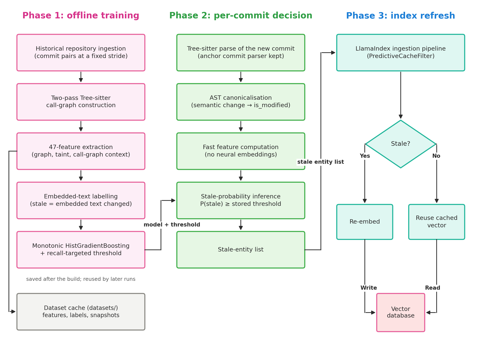

# Predictive Semantic Cache Invalidation (`predictive-semantic-cache`)

[](https://predictive-semantic-cache-invalidation.readthedocs.io/en/latest/)
[](https://github.com/KMohnishM/predictive-semantic-cache-invalidation/actions/workflows/ci.yml)
[](LICENSE)
[](https://pypi.org/project/predictive-semantic-cache/)
[](https://pypi.org/project/predictive-semantic-cache/)

**Predictive Semantic Cache Invalidation** is an intelligent caching and re-indexing framework for Retrieval-Augmented Generation (RAG) and semantic code search systems.

When codebases evolve across Git commits, naively re-embedding every entity or file incurs prohibitive LLM and embedding API costs. Conversely, re-embedding only directly touched files ignores ripple effects in dependent call graphs. `predictive-semantic-cache` solves this by using **Tree-Sitter AST call graphs**, **structural drift feature extraction**, and **calibrated machine learning** (LightGBM, Random Forest, HistGradientBoosting) to predict which code entities' semantic representations have drifted enough to require cache invalidation.

---

## Documentation

Comprehensive documentation, full API references, and step-by-step guides are available at **[Predictive Semantic Cache](https://predictive-semantic-cache-invalidation.readthedocs.io/en/latest/)**.

- **[Quickstart Guide](https://predictive-semantic-cache-invalidation.readthedocs.io/en/latest/quickstart/)**: Get up and running in under 5 minutes.
- **[Default ML vs Custom Model](https://predictive-semantic-cache-invalidation.readthedocs.io/en/latest/guides/default_vs_custom_model/)**: Learn how zero-config bundled prediction works vs. training on your own codebase.
- **[LlamaIndex Integration](https://predictive-semantic-cache-invalidation.readthedocs.io/en/latest/guides/llama_index/)**: Plug directly into LlamaIndex ingestion pipelines with `PredictiveCacheFilter`.
- **[GitHub Actions CI/CD](https://predictive-semantic-cache-invalidation.readthedocs.io/en/latest/guides/github_actions/)**: Automate selective cache invalidation in your CI/CD workflows.
- **[Python API Reference](https://predictive-semantic-cache-invalidation.readthedocs.io/en/latest/api/client/)**: Auto-generated docstrings and signatures for all core modules.

---

## System Architecture



The framework operates across three key phases:
1. **Offline Ground-Truth & Model Training**: Extracts call graphs, computes structural and semantic drift via leave-one-out rank displacement, and trains recall-calibrated ML models.
2. **Real-Time Git Commit Invalidation**: Processes git diffs, extracts lightweight static and evolutionary features, and evaluates code nodes through the trained predictor to identify stale entities.
3. **Production Vector-Store Refresh**: Selectively routes only stale nodes to neural embedding models, preserving fresh cached representations.

---

## Key Features

- **Tree-Sitter AST & Call-Graph Parser**: Multi-language parsing of classes, methods, functions, and call relationships without requiring full compiler environments.
- **Graph & Evolution Feature Extraction**: Computes structural metrics (centrality, degree, depth), evolutionary stats (churn, diff size, modification frequency), and Graph Transition Descriptors (GTD).
- **ML Drift Prediction**: Supports LightGBM, Random Forest, HistGradientBoosting, and ExtraTrees with recall-calibrated decision thresholds to ensure stale entities are never missed.
- **Drop-in LlamaIndex Integration**: Custom `CodeGraphNodeParser` and `PredictiveCacheFilter` transformation components that fit directly into standard LlamaIndex ingestion pipelines.
- **Comprehensive Benchmarking Suite**: CLI and reporting utilities to evaluate retrieval retention vs. full re-indexing and update cost.

---

## Installation

### Core (Lightweight)
```bash
pip install predictive-semantic-cache
```

### With LlamaIndex Integration
```bash
pip install "predictive-semantic-cache[llamaindex]"
```

### With LightGBM Support
```bash
pip install "predictive-semantic-cache[lightgbm]"
```

### All Dependencies (Benchmarking, Evaluation & Embeddings)
```bash
pip install "predictive-semantic-cache[all]"
```

---

## Quickstart

### 1. Zero-Config Predictive Invalidation (Default ML)

The easiest way to use the library. Automatically loads the bundled 50 KB pre-trained model:

```python
from predictive_semantic_cache import PredictiveCache

# Point to your repository
cache = PredictiveCache(repo_path=".")

# Detect functions and classes requiring re-embedding between Git commits
stale_entities = cache.get_stale_entities(from_commit="HEAD~1", to_commit="HEAD")

print(f"Entities requiring re-indexing: {len(stale_entities)}")
for ent in stale_entities:
    print(f" -> {ent.name} in {ent.file_path}:{ent.lineno}")
```

---

### 2. Custom Model Training & Inference

You can also train a custom `DriftPredictor` model tailored specifically to your codebase's architecture and Git history:

```python
from predictive_semantic_cache import PredictiveCache

# Point to your own fine-tuned .pkl artifact
cache = PredictiveCache(
    repo_path=".",
    model_path="models/custom_drift_predictor.pkl",
    threshold=0.55,  # Optional custom threshold
)
stale_entities = cache.get_stale_entities("HEAD~1", "HEAD")
```
*For complete instructions on extracting features and training your own model, see [examples/05_train_custom_model.py](examples/05_train_custom_model.py).*

---

### 3. LlamaIndex Ingestion Pipeline

Integrate predictive cache invalidation directly into your LlamaIndex RAG pipeline:

```python
from predictive_semantic_cache.integrations.llama_index import (
    build_predictive_ingestion_pipeline,
)

# Build pipeline (predictor_or_path=None auto-loads the default model!)
pipeline = build_predictive_ingestion_pipeline(
    repo_path="./my-repo",
    predictor_or_path=None,  # Or pass your custom model path
)

nodes = pipeline["node_parser"].parse_repository()
stale_nodes = pipeline["cache_filter"](nodes)

# Only stale nodes proceed to embedding and vector store upsert!
print(f"Total nodes: {len(nodes)} -> Re-embedding only: {len(stale_nodes)}")
```

---

## Examples & Tutorials

Check out the [`examples/`](examples/) directory for complete, copy-pasteable workflows:

- **[01_basic_usage.py](examples/01_basic_usage.py)**: Basic API, summary statistics, and graph heuristics.
- **[02_llama_index_pipeline.py](examples/02_llama_index_pipeline.py)**: End-to-end LlamaIndex RAG ingestion pipeline.
- **[03_github_actions/](examples/03_github_actions/)**: Ready-to-use GitHub Actions workflow and re-indexing script.
- **[04_benchmark_custom_repo.py](examples/04_benchmark_custom_repo.py)**: Running comparative benchmarks.
- **[05_train_custom_model.py](examples/05_train_custom_model.py)**: Training a custom `DriftPredictor` model on your commit history.

---

### 2. Standalone Code Graph & AST Parsing

```python
from predictive_semantic_cache import TreeSitterRepoParser

# Initialize parser on a target repository
parser = TreeSitterRepoParser(repo_path="./my-repo")
parser.parse_directory("./my-repo")

# Access extracted entities (classes, functions, methods)
for entity_id, entity in parser.entities.items():
    print(f"Entity: {entity_id} ({entity.entity_type}) at {entity.file_path}:{entity.lineno}")

# Query caller/callee relationships
graph = parser.get_graph()
callers = list(graph.predecessors("my_module::func_a"))
callees = list(graph.successors("my_module::func_a"))
```

---

### 3. Extract Features and Predict Drift

```python
from predictive_semantic_cache import FeatureExtractor, DriftPredictor

# Extract structural and evolutionary features
extractor = FeatureExtractor(repo_parser=parser, parser_a=previous_parser)
features = extractor.extract_features(
    entity_id="my_module::func_a",
    modified_entities={"my_module::func_b"}
)

# Load predictor and evaluate drift
predictor = DriftPredictor.load_artifact("drift_predictor.pkl")
is_stale = predictor.predict([list(features.values())])[0]
print(f"Should invalidate cache: {bool(is_stale)}")
```

---

## Benchmarking CLI

The package bundles a reproducible retrieval benchmark CLI to measure staleness cost and retrieval fidelity (Lost@k, MRR, NDCG):

```bash
predictive-cache-benchmark --repo-path ./my-repo --num-commits 10 --strategies predictive_ml,changed_only,full_reindex
```

---

## Authors & Contributors

- **Kodukulla Mohnish Mythreya** ([@KMohnishM](https://github.com/KMohnishM) - `kmohnishm@gmail.com`)
- **Aditya Narayan Bhandari** ([@TheUnnamedOne-design](https://github.com/TheUnnamedOne-design) - `aditya07.11.04.12@gmail.com`)
- **Tarun Chebolu** ([@NonCompactdesign](https://github.com/NonCompactdesign) - `chebolutarun5@gmail.com`)

---

## License

This project is licensed under the Apache 2.0 License. See the [LICENSE](LICENSE) file for details.
