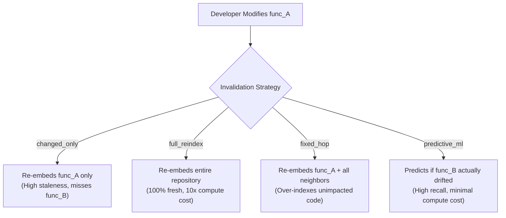

# The Semantic Cache Invalidation Problem

Why does naive diff-based cache invalidation fail in code RAG?

---

## 1. Direct vs Transitive Semantic Drift

In code retrieval systems, functions and classes are chunked, embedded, and stored in a vector index.

When a developer edits `func_A()`, two kinds of changes occur:

1. **Direct Drift**: The source code of `func_A()` itself changes.
2. **Transitive Drift**: Another function `func_B()` calls `func_A()`. While `func_B()`'s source code was not touched, its runtime behavior, caller semantics, or docstring assumptions are now altered.

If an AI code assistant only retrieves code based on the untouched source of `func_B()`, it will retrieve outdated or conflicting context.

---

## 2. Invalidation Strategies Compared

---

## 3. Mathematical Formulation

Let $G = (V, E)$ be the repository call graph where vertices $v \in V$ represent functions or classes, and directed edges $(u, v) \in E$ represent invocations ($u$ calls $v$).

Between commit $C_t$ and $C_{t+1}$, a subset $V_{\text{mod}} \subseteq V$ is modified.

For each candidate entity $v \in V$, the predictive model estimates the probability of semantic drift:

$$P(\text{drift}(v) = 1 \mid \mathbf{x}_v)$$

where $\mathbf{x}_v$ is the feature vector capturing AST complexity, Graph Transition Descriptors (GTD), and topological distance to $V_{\text{mod}}$.
