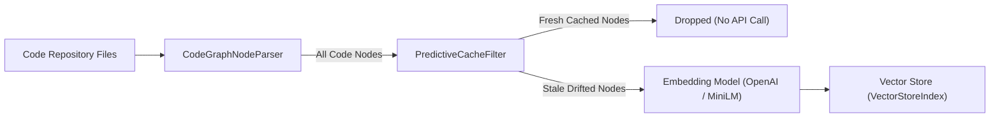

# LlamaIndex Integration

`predictive-semantic-cache` provides first-class integration with [LlamaIndex](https://www.llamaindex.ai/) through custom AST node parsing and predictive caching filters.

---

## 1. Installation

Install with the `[llamaindex]` extra:

```bash
pip install "predictive-semantic-cache[llamaindex]"
```

---

## 2. Ingestion Pipeline Architecture



---

## 3. End-to-End Example

```python
from pathlib import Path
from llama_index.core import SimpleDirectoryReader, VectorStoreIndex
from predictive_semantic_cache.integrations.llama_index import (
    build_predictive_ingestion_pipeline,
)

repo_dir = str(Path(".").resolve())

# Step 1: Build the pipeline components
# Leaving predictor_or_path=None automatically uses the default bundled model!
pipeline = build_predictive_ingestion_pipeline(
    repo_path=repo_dir,
    predictor_or_path=None,  # Or pass 'models/custom_drift_predictor.pkl'
    threshold=0.5,
)

node_parser = pipeline["node_parser"]
cache_filter = pipeline["cache_filter"]

# Step 2: Parse repository code into call-graph TextNodes
nodes = node_parser.parse_repository()
print(f"Parsed {len(nodes)} code nodes.")

# Step 3: Run the predictive cache filter
# Only nodes whose semantics actually drifted pass through!
stale_nodes = cache_filter(nodes)
print(f"Re-indexing {len(stale_nodes)} stale nodes instead of {len(nodes)} total.")

# Step 4: Upsert only the stale nodes into your Vector Index
# index = VectorStoreIndex.from_vector_store(...)
# index.insert_nodes(stale_nodes)
```

---

## 4. Node Relationships & Metadata

Nodes created by `CodeGraphNodeParser` carry rich structural metadata:

- `callers`: List of entity IDs that invoke this function/class.
- `callees`: List of entity IDs invoked by this function/class.
- `file_path`: Source file path relative to repo root.
- `lineno` / `end_lineno`: Exact span in source code.
- `entity_type`: `function`, `method`, or `class`.
