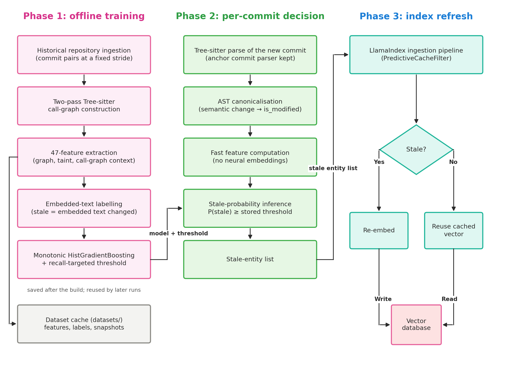

# Predictive Semantic Cache

**Predictive Semantic Cache Invalidation** is an intelligent caching and re-indexing framework for Retrieval-Augmented Generation (RAG) and semantic code search systems.

By combining **Tree-sitter AST parsing**, **dependency graph feature extraction**, and **machine learning classification**, it detects which code entities (functions, classes) have experienced semantic drift across Git commits and selectively re-indexes only those affected.

---

## Why Predictive Semantic Cache?

When code changes in a repository:

1. **Re-embedding everything (Full Re-index)**: Guaranteed to be fresh, but prohibitively expensive and slow on large codebases. Every commit burns API rate limits and embedding costs ($$$).
2. **Re-embedding only modified files (Changed Only)**: Fast and cheap, but misses downstream functions whose meaning or context drifted because their dependencies changed. This results in **stale semantic embeddings** and hallucinated RAG responses.
3. **Predictive Semantic Cache**: Predicts exactly which downstream callers and dependent entities experienced semantic drift. Achieves **~95–100% recall** while re-embedding only **10–25%** of the codebase, saving up to **80% in vector indexing costs**.

---

## Core Capabilities

- **Zero-Config Default ML**: Shipped with a pre-trained, calibrated 50 KB model that works immediately out-of-the-box.
- **Custom Model Training**: Train fine-tuned models on your proprietary repository's historical commits with high target recall.
- **Deterministic Graph Heuristics**: Fallback to fast call-graph traversal (0-hop, 1-hop, 2-hop) when machine learning inference is not desired.
- **Drop-in LlamaIndex Ingestion Pipeline**: Native `PredictiveCacheFilter` that seamlessly drops fresh nodes before they hit your embedding model and vector store.
- **CI/CD Ready**: Easy to drop into GitHub Actions workflows to keep production Vector DBs continuously up to date on every PR.
- **Benchmarking Suite**: Built-in CLI tool (`predictive-cache-benchmark`) to audit and compare invalidation strategies on any repository.

---

## Authors

- **Kodukulla Mohnish Mythreya** ([@KMohnishM](https://github.com/KMohnishM)) - [kmohnishm@gmail.com](mailto:kmohnishm@gmail.com)
- **Aditya Narayan Bhandari** ([@TheUnnamedOne-design](https://github.com/TheUnnamedOne-design)) - [aditya07.11.04.12@gmail.com](mailto:aditya07.11.04.12@gmail.com)
- **Tarun Chebolu** ([@NonCompactdesign](https://github.com/NonCompactdesign)) - [chebolutarun5@gmail.com](mailto:chebolutarun5@gmail.com)
